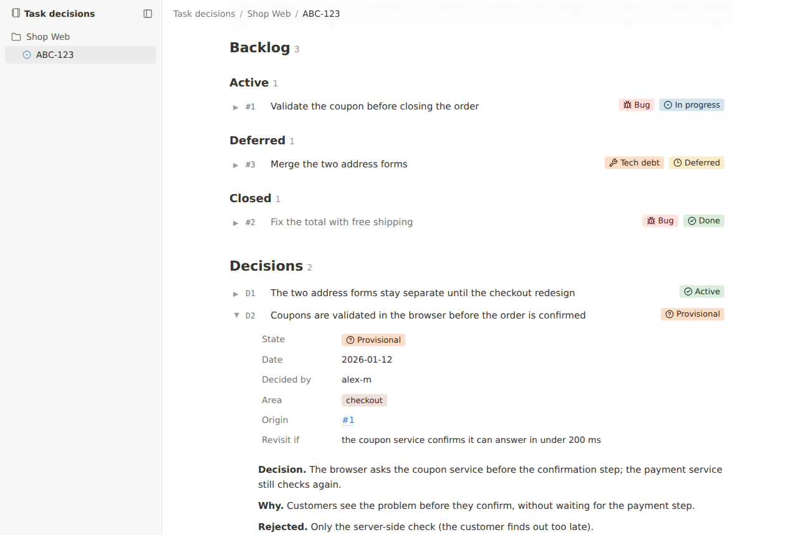

# task-decisions

[](https://github.com/brasillero/task-decisions/releases)
[](https://github.com/brasillero/task-decisions/actions/workflows/test.yml)
[](LICENSE)

An [agent skill](https://agentskills.io) that keeps a **backlog** and a **decision log** for every task, inside the repository, in plain Markdown.

Ask your agent to "record a decision" or "what is still open?" and it writes and reads `.task-decisions/`: what is left to do, what was decided, **why**, and what was rejected. Works with Claude Code, Codex, Cursor and any agent that supports skills.

Install with `npx skills add brasillero/task-decisions`, then ask your agent: "Start notes for ABC-123."

## Why

- **Decisions outlive the conversation.** Each records the choice, its reason, the rejected options and any condition for revisiting it, so "why did we do X?" still has an answer months later.
- **Deferred work stays recorded.** Each deferred item keeps its reason and a checkable trigger; closed items keep their full text.
- **It lives with the code.** Notes are committed on the task's branch and reach the main branch with the same merge request, so the whole team sees them. Prefer them private? Keep them local only.
- **Strict shapes, plain files.** Fixed headings and fields keep people, agents and tools in agreement, and a bundled check flags anything out of shape. No database, no service, no lock-in.

## Install

With the [skills CLI](https://skills.sh):

```sh
npx skills add brasillero/task-decisions
```

That asks which agents and scope to use. To install without prompts, name the agents and add `--yes`:

<!-- x-release-please-start-version -->
```sh
# For you, in every project
npx skills add brasillero/task-decisions --global --skill task-decisions --agent claude-code codex cursor --yes

# Pinned to a release
npx skills add 'brasillero/task-decisions#v1.1.0' --skill task-decisions --agent claude-code codex cursor --yes
```
<!-- x-release-please-end -->

| To | Run |
|---|---|
| update | `npx skills update task-decisions` |
| remove | `npx skills remove task-decisions` |

Add `--global` to both for a global install. Without the CLI, copy or link [`skills/task-decisions/`](skills/task-decisions) into your agent's skills folder (`~/.claude/skills/` for Claude Code, `~/.agents/skills/` for Codex and others).

**Requirements:** the helper scripts need Node.js 20+ and use git to identify the repository; they have no third-party dependencies. Installing with the CLI also needs Node.js; a manual install does not.

## Use

Talk to your agent in plain words, from inside a repository:

| You say | The agent |
|---|---|
| "Start notes for ABC-123." | creates the task folder from the templates |
| "Add an item: the coupon is not validated before closing the order." | adds `#n` to the task's backlog |
| "Record a decision: address validation stays in the browser; revisit if the postcode service gets faster." | adds `Dn` with its reason, rejected options and revisit condition |
| "Close #2, done in `a1b2c3d`." | closes the item, keeping its text, with the commit as evidence |
| "What is open?" · "Why did we keep the two address forms?" | answers from the files, with references |
| "Bring our TODO.md into task-decisions." | proposes a mapping and waits for your agreement before importing |
| "Show the notes." | starts the viewer |

The first time, it creates `.task-decisions/README.md` and asks whether the notes are committed or local only, and for the project's language, tracker, key prefix and areas.

**How it works.** The skill is instructions, not a service: before editing notes, the agent reads the skill's rules, the project's settings and the file templates; after each change it runs the shape check. It asks for required values the request does not give, commits only when asked (or when the project says so) and never pushes unless asked.

**Alongside your tools.** Use it for task notes next to your issue tracker: it can prepare an item's text for the tracker, but does not manage the tracker's backlog. It can import existing ADRs with your agreement, but writes decisions in `.task-decisions/` rather than maintaining `docs/adr/`.

## What it writes

```
<repository>/
└── .task-decisions/
    ├── README.md              the project: language, tracker, areas, vocabulary
    └── tasks/
        └── ABC-123/
            ├── README.md      state, ticket, branch, merge request, summary
            ├── backlog.md     #1, #2…  Active / Deferred / Closed
            ├── decisions.md   D1, D2…  append-only
            └── reports/       reviews, investigations, plans
```

A decision looks like this:

```markdown
### D2 · Provisional · Coupons are validated in the browser before the order is confirmed
- date: 2026-01-12
- decided by: alex-m
- origin: #1
- area: checkout
- revisit if: the coupon service confirms it can answer in under 200 ms

**Decision.** The browser asks the coupon service before the confirmation step; the payment service still checks again.

**Why.** Customers see the problem before they confirm, without waiting for the payment step.

**Rejected.** Only the server-side check (the customer finds out too late).
```

The full rules are in [`references/rules.md`](skills/task-decisions/references/rules.md), and every file's shape in [`references/shapes.md`](skills/task-decisions/references/shapes.md). [`examples/shop-web/`](examples/shop-web/.task-decisions) is a small made-up project with open, deferred and closed items, an active and a provisional decision, and a report.

## Viewer and check



```sh
node "<skill folder>/scripts/serve.mjs" "<repository root>"   # read-only viewer; Ctrl+C stops it
node "<skill folder>/scripts/check.mjs" "<repository root>"   # lists entries out of shape
```

Replace the placeholders with real paths (the repository root defaults to the current folder). The viewer runs on `http://localhost:4400`. The check exits with 0 when everything is in shape, 1 when it reports problems, and 2 when there is no `.task-decisions/` folder.

Try them on the example from a clone of this repository:

```sh
node skills/task-decisions/scripts/serve.mjs examples/shop-web
```

| Variable | Default | Meaning |
|---|---|---|
| `PORT` | `4400` | the viewer's port |
| `TASK_DECISIONS_HOSTS` | — | extra host names the viewer answers (comma-separated), e.g. behind a proxy of your own |

## Privacy and security

- **Committed notes are as visible as your code:** anyone who can read the repository can read them. Keep secrets and personal data out; choose local-only notes when they should stay on your machine.
- **The viewer is local and read-only.** It listens on `127.0.0.1` and answers only requests addressed to a localhost name (`localhost`, `127.0.0.1`, `[::1]`) or to a name in `TASK_DECISIONS_HOSTS`. It cannot read notes files outside `.task-decisions/`, including through symbolic links. Its page and icons are bundled, and it makes no requests to external services.

## Contributing

```sh
node --test tests/*.test.mjs
```

- Commit messages follow [Conventional Commits](https://www.conventionalcommits.org). [release-please](https://github.com/googleapis/release-please) turns them into the changelog and a release PR; merging that PR publishes the release. See [`CHANGELOG.md`](CHANGELOG.md).
- [`evals/`](evals/README.md) holds behaviour cases for agents using the skill: prompt, starting state, and what a correct run does.

## License

[MIT](LICENSE). The viewer's icons come from [Lucide](https://lucide.dev): ISC, and MIT for icons derived from Feather ([notices](skills/task-decisions/THIRD_PARTY_NOTICES.md)).
